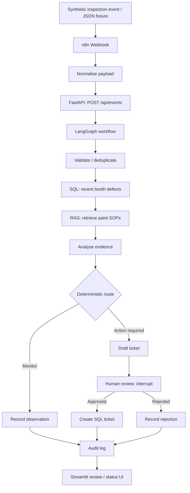
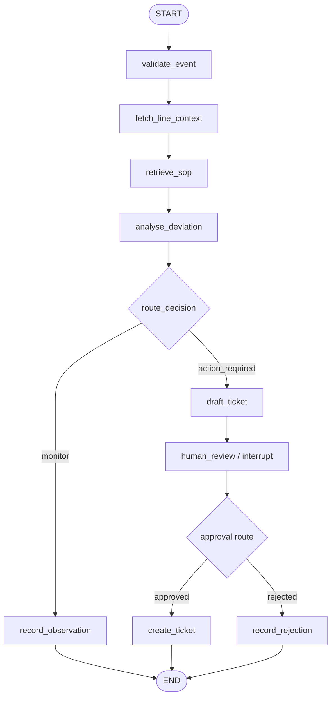

# PaintOps — Weekend Build Plan

> **Purpose:** Build a small, credible industrial AI/process-automation portfolio project with **Python, LangGraph, n8n, RAG, SQL, and human approval**.
>
> **Target effort:** 12–15 focused hours over one weekend.
>
> **Build style:** Python-first backend, one LangGraph workflow, one n8n workflow, one small Streamlit review UI. Use synthetic data only.

---

## 0. Instructions for Cursor Auto

Treat this document as the product specification. Implement the project in small, verifiable stages rather than generating the entire application at once.

### Working rules

1. **Read this plan before editing files.** Inspect the repository first. If it is empty, initialise the project. If files already exist, preserve useful work and explain any structural changes.
2. **Implement one phase at a time.** At the end of each phase, run the relevant tests or smoke checks, fix failures, and summarise what changed before moving on.
3. **Keep the MVP small.** Do not add multi-agent orchestration, a React frontend, real PLC/OPC-UA/MQTT integration, SAP/ERP integration, authentication systems, Kubernetes, or multi-plant support.
4. **Do not invent industrial standards or safety limits.** All process data, SOPs, thresholds, and test cases are synthetic examples for a portfolio demonstration. Label them clearly.
5. **Do not allow the LLM to make safety-critical decisions.** Use deterministic Python rules for routing and ticket-creation eligibility. The LLM may summarise evidence and suggest possible causes, but a human must approve every action ticket.
6. **Never create a ticket before approval.** The only code path that inserts an action ticket must be the approved branch of the graph. Rejections must never create active tickets.
7. **Make ticket creation idempotent.** Replaying an approval request must not create duplicate tickets.
8. **Keep secrets out of Git.** Use `.env`, provide `.env.example`, and never log API keys or full environment variables.
9. **Make tests independent of paid LLM APIs.** Use deterministic fake/stub LLM and retriever implementations in unit tests. The app should support a deterministic demo mode.
10. **Pin compatible dependency versions** in the project lockfile or dependency file after checking current package APIs. Do not blindly copy deprecated imports or examples from old tutorials.
11. **Prefer clear, typed, readable code** over abstractions. Add type hints, docstrings for important functions, useful errors, and structured logs.
12. **Do not claim cloud deployment is complete** unless it has actually been deployed. The MVP only needs to be cloud-ready and documented.

### Required final outcome

A user can submit a synthetic paint-quality inspection event. The application validates and stores it, checks recent events in SQL, retrieves relevant synthetic SOP documents, analyses the evidence, and either records a monitor-only observation or drafts an action ticket. An action ticket pauses at a LangGraph human-approval interrupt. A reviewer can approve or reject it in Streamlit. Approval resumes the same graph thread and creates exactly one SQL ticket. Rejection records the decision and creates no ticket. The workflow can also be triggered through n8n.

---

## 1. Project Overview

### Project name

**PaintOps — Agentic Quality Deviation Investigation for Automotive Manufacturing**

### One-line pitch

An agentic quality-investigation workflow that turns synthetic automotive paint-inspection events into evidence-backed, human-approved maintenance or quality actions using LangGraph, n8n, RAG, and SQL.

### Problem being demonstrated

An automotive paint shop receives inspection events from a computer-vision quality station. An individual defect may be isolated, but repeated defects in the same booth can indicate a process issue that deserves investigation. PaintOps correlates the incoming event with recent history, searches relevant standard operating procedures (SOPs), prepares an action proposal, and asks a human reviewer to approve or reject the proposed ticket.

### Relationship to an existing AI portfolio

This project should complement existing work in industrial inspection/anomaly detection, RAG, FastAPI, and TypeScript agents. Do **not** build another vision model or another general-purpose agent dashboard. PaintOps demonstrates the step after detection: operational investigation, workflow orchestration, persistence, integration, and human-supervised action.

### Explicit safety and scope boundaries

- All machine events, defect measurements, SOPs, thresholds, and outcomes are synthetic.
- PaintOps is a **decision-support prototype**, not a validated industrial control or quality system.
- It must not connect to or control a PLC, robot, production line, or machine setting.
- It must not automatically stop production, change process parameters, release/reject a vehicle, or authorise rework.
- Every proposed action ticket requires a human approval step.
- The README and UI must visibly state that data and procedures are synthetic and not suitable for real production decisions.

---

## 2. MVP User Journey

### Example event

Use this synthetic event shape (timestamps and values are illustrative):

```json
{
  "event_id": "QC-2026-00421",
  "timestamp": "2026-10-30T09:15:00Z",
  "plant_id": "PLANT-01",
  "production_line": "PAINT-LINE-02",
  "booth_id": "BOOTH-03",
  "body_id": "CAR-008721",
  "defect_type": "orange_peel",
  "model_confidence": 0.94,
  "telemetry": {
    "booth_temperature_c": 24.5,
    "humidity_pct": 72.0,
    "airflow_m_s": 1.8
  },
  "source": "synthetic_cv_inspection"
}
```

### Expected processing

1. Validate the payload, confidence range, timestamp, and required identifiers.
2. Store the inspection event. Enforce `event_id` uniqueness so webhook retries do not create duplicate events.
3. Query recent events for the same booth and defect type over a configurable rolling time window.
4. Retrieve up to three relevant synthetic paint-quality SOP chunks.
5. Produce a structured analysis with suspected contributing factors, evidence, uncertainty, and SOP references.
6. Apply deterministic routing rules in Python. The LLM must not choose whether to bypass review.
7. If the event is not actionable, record a monitor-only observation and finish.
8. If action is required, create a structured ticket draft and pause at a LangGraph `interrupt()`.
9. Show the pending draft and its evidence in the Streamlit review inbox.
10. On approval, resume the same LangGraph thread and insert exactly one action ticket.
11. On rejection, resume the same thread, record reviewer/reason, and do not insert an action ticket.
12. Store auditable workflow events for the important steps.

### Scope of defect categories

Use only a small set, such as:

- `orange_peel`
- `runs_sags`
- `dust_inclusion`
- `uneven_coverage`

No image model is required. Events are generated JSON fixtures representing inspection-system output.

---

## 3. High-Level Architecture



### Component responsibilities

| Component | Responsibility | Must not do |
|---|---|---|
| n8n | Receive and normalise an event; call FastAPI | Perform the investigation or approve tickets |
| FastAPI | Validate API requests, start/resume graph runs, expose review endpoints | Contain the whole agent workflow in route handlers |
| LangGraph | Own state, nodes, conditional routing, interrupt and resume | Directly control industrial equipment |
| LlamaIndex + Chroma | Retrieve relevant synthetic SOP chunks | Invent procedures when retrieval is empty |
| SQLAlchemy + SQLite | Persist event/investigation/ticket/audit records | Store secrets |
| LangGraph SQLite checkpointer | Persist graph execution state for resumption | Replace the application/business tables |
| Streamlit | Display event/investigation details and collect reviewer decisions | Write tickets directly to SQL |

**Important separation:** use one SQLite database for business records and another SQLite file for LangGraph checkpoints. The checkpointer is not the application data model.

---

## 4. Technology Choices

Keep the stack familiar and small:

| Area | Choice |
|---|---|
| Language | Python 3.11 or 3.12 (choose a version compatible with all selected packages) |
| API | FastAPI + Uvicorn |
| Agent orchestration | LangGraph Python `StateGraph` |
| Graph persistence | `langgraph-checkpoint-sqlite` (`SqliteSaver` for the single-process MVP) |
| LLM interface | LangChain chat-model adapter configured via environment variables |
| Local LLM option | Ollama, if available; otherwise configure a supported hosted provider |
| Structured output | Pydantic models |
| RAG | LlamaIndex + Chroma |
| Embeddings | Local Hugging Face sentence-transformer model |
| Application DB | SQLite + SQLAlchemy 2.x |
| UI | Streamlit |
| Integration | n8n Community Edition, one workflow |
| Tests | pytest + FastAPI TestClient/httpx |
| Packaging | Docker Compose |

### LLM configuration

Use one provider abstraction, not separate provider logic throughout the codebase.

Environment variables should include:

```dotenv
LLM_PROVIDER=ollama
LLM_MODEL=qwen2.5:3b
OLLAMA_BASE_URL=http://host.docker.internal:11434
LLM_TEMPERATURE=0
```

If implementing Ollama is inconvenient in the runtime environment, support one alternative provider through the same small adapter. Document the exact required key in `.env.example`. Do not make a paid provider mandatory to run the tests.

### Deterministic demo mode

Add `DEMO_MODE=true`. In demo mode:

- Use a deterministic analysis stub with predictable structured outputs based on event fields and retrieved context.
- Use the real graph, SQL tools, RAG retrieval, conditional routes, checkpointing, and approval flow.
- Do not silently pretend a real LLM was called. Show `analysis_provider: "demo_rules"` or equivalent in the investigation metadata.

This makes the project demonstrable without API keys while keeping the workflow architecture real.

---

## 5. Data Model

Use SQLAlchemy models and create tables at application startup for this MVP. Add a seed command for synthetic sample records. Use UTC timestamps.

### 5.1 `inspection_events`

| Field | Type | Notes |
|---|---|---|
| `event_id` | string | Primary key, provided by source |
| `timestamp` | datetime | Event time in UTC |
| `plant_id` | string | Synthetic plant identifier |
| `production_line` | string | E.g. `PAINT-LINE-02` |
| `booth_id` | string | Used for correlation |
| `body_id` | string | Synthetic vehicle/body identifier |
| `defect_type` | string | Controlled vocabulary |
| `model_confidence` | float | Must be between 0 and 1 |
| `telemetry_json` | JSON/text | Synthetic booth readings |
| `source` | string | Default `synthetic_cv_inspection` |
| `created_at` | datetime | Database insertion time |

### 5.2 `investigations`

| Field | Type | Notes |
|---|---|---|
| `investigation_id` | UUID/string | Primary key |
| `event_id` | string | Foreign key, unique for the MVP |
| `thread_id` | string | Unique LangGraph thread identifier |
| `status` | string | `processing`, `awaiting_approval`, `approved`, `rejected`, `monitored`, `failed` |
| `recurrence_count` | integer | Count in configured time window, including current event |
| `severity` | string | `low`, `medium`, `high`, `critical` |
| `suspected_cause` | text | Hypothesis, not confirmed root cause |
| `evidence_json` | JSON/text | Evidence used in the analysis |
| `sop_references_json` | JSON/text | SOP IDs/titles/chunk references |
| `proposed_action` | text | Action proposal |
| `analysis_provider` | string | E.g. `ollama`, `gemini`, `demo_rules` |
| `reviewer` | string/null | Populated on decision |
| `review_comment` | text/null | Optional reviewer reason/comment |
| `created_at` | datetime | UTC |
| `updated_at` | datetime | UTC |

### 5.3 `action_tickets`

| Field | Type | Notes |
|---|---|---|
| `ticket_id` | UUID/string | Primary key or readable generated ID |
| `investigation_id` | string | Foreign key and **unique constraint** |
| `event_id` | string | Foreign key |
| `ticket_type` | string | `quality_inspection` or `maintenance_inspection` |
| `priority` | string | `low`, `medium`, `high`, `critical` |
| `title` | string | Short title |
| `description` | text | Structured evidence-backed summary |
| `sop_references_json` | JSON/text | Sources used |
| `status` | string | E.g. `open` |
| `approved_by` | string | Reviewer identifier entered in demo |
| `approved_at` | datetime | UTC |
| `created_at` | datetime | UTC |

### 5.4 `audit_events`

| Field | Type | Notes |
|---|---|---|
| `audit_id` | integer | Primary key |
| `investigation_id` | string | Indexed foreign key |
| `node_name` | string | Graph node or API action |
| `action` | string | E.g. `event_received`, `sop_retrieved`, `approval_rejected` |
| `details_json` | JSON/text | Safe, non-secret metadata |
| `created_at` | datetime | UTC |

### Database invariants

- One inspection row per `event_id`.
- One investigation per `event_id` for this MVP.
- One ticket per `investigation_id`.
- An action ticket can only be created when the investigation is approved.
- Rejected and monitored investigations must not have action tickets.
- Retried API calls must return the existing event/investigation instead of starting duplicate work.

---

## 6. LangGraph Design

### 6.1 Graph state

Use a `TypedDict` for graph state. Keep raw data and structured results in state; build prompt strings inside nodes.

Suggested fields:

```python
from typing import Any, Literal, TypedDict

class PaintOpsState(TypedDict, total=False):
    event: dict[str, Any]
    investigation_id: str
    thread_id: str

    recent_events: list[dict[str, Any]]
    recurrence_count: int

    sop_results: list[dict[str, Any]]
    analysis: dict[str, Any]
    severity: Literal["low", "medium", "high", "critical"]
    route: Literal["monitor", "action_required"]

    ticket_draft: dict[str, Any]
    approval_decision: dict[str, Any]
    approval_status: Literal["approved", "rejected"]
    reviewer: str
    review_comment: str
    ticket_id: str

    errors: list[str]
```

Use Pydantic models for input event validation, analysis output, and ticket draft validation. Never rely on the LLM to return arbitrary JSON without validation.

### 6.2 Nodes

| Node | Inputs | Work | State updates |
|---|---|---|---|
| `validate_event` | `event` | Validate event schema and supported defect type; verify it has been stored | Normalised event or validation error |
| `fetch_line_context` | event identifiers | Query recent events for same booth and defect type within configured time window | `recent_events`, `recurrence_count` |
| `retrieve_sop` | defect type, context | Retrieve top-k relevant SOP chunks from LlamaIndex/Chroma | `sop_results` |
| `analyse_deviation` | event, recent events, SOP results | LLM or demo adapter returns structured findings and possible causes | `analysis`, `severity` |
| `route_decision` | recurrence, severity, evidence | Apply deterministic Python policy | `route` |
| `draft_ticket` | analysis, evidence, SOP results | Create a structured draft; clearly mark hypotheses and missing evidence | `ticket_draft` |
| `human_review` | ticket draft | Call `interrupt()` and wait for approve/reject payload | `approval_status`, reviewer, comment |
| `create_ticket` | approved state | Insert one ticket transactionally and update investigation status | `ticket_id`, status |
| `record_rejection` | rejected state | Update investigation and audit log; do not insert ticket | status and audit record |
| `record_observation` | monitor route | Mark investigation as monitored and write audit record | status and audit record |

### 6.3 Conditional routing policy

Put routing logic in ordinary, separately tested Python functions. The LLM can provide severity and rationale, but it cannot override hard-coded routing rules.

Use simple **synthetic demo thresholds**, configurable in `settings.py`:

- `RECURRENCE_WINDOW_MINUTES=60`
- `RECURRENCE_ACTION_THRESHOLD=3` (count includes current event)
- `HIGH_SEVERITY_ACTION_REQUIRED=true`

Suggested route:

- `action_required` if the same defect has occurred at least three times in the same booth within the configured window, or if validated analysis severity is `high` or `critical`.
- Otherwise `monitor`.
- If SOP retrieval returns no useful evidence, do not invent an SOP. Include `no_relevant_sop_found=true` in analysis and make the ticket draft explicitly state that manual SOP verification is required if the deterministic policy still calls for review.

These values are for the synthetic demonstration only, not real paint-shop limits or an industrial quality policy.

### 6.4 Graph topology



### 6.5 Human approval and resumption

Use LangGraph's `interrupt()` and a persistent SQLite checkpointer.

Requirements:

- Compile the graph with a persistent checkpointer.
- Use the investigation UUID as `thread_id` and keep it stable.
- The `human_review` node must call `interrupt()` before doing any side effects. A node is re-entered from its start when resumed; code before the interrupt can run again.
- The interrupt payload must include the investigation ID, draft ticket, evidence summary, SOP references, and a clear decision request.
- Resume with `Command(resume={...})` and the **same** `thread_id`.
- Use a typed/validated decision object with `decision` (`approved` or `rejected`), `reviewer`, and optional `comment`.
- Route to `create_ticket` only for an approved decision. Route to `record_rejection` otherwise.
- Do not perform external or irreversible side effects inside the interrupt node before the interrupt.

Use `SqliteSaver` for this single-process local MVP. Run the API with one worker while using the synchronous saver, and document that this is not a horizontally scalable production setup. If choosing async graph execution and `AsyncSqliteSaver`, manage its connection lifecycle correctly in FastAPI lifespan. Do not mix sync/async patterns casually.

### 6.6 Failure behaviour

- Invalid event: return HTTP 422 before starting the graph.
- Duplicate event ID: return existing record/status; do not start a duplicate graph run.
- LLM unavailable: in demo mode, use the deterministic analysis adapter; otherwise return a clear failure or route to a manual-review state—never invent analysis.
- Empty SOP retrieval: continue only with an explicit evidence-gap warning; never fabricate citations.
- Ticket insert failure: surface error and leave the investigation recoverable; rely on the unique constraint and idempotent insert.
- Unexpected exception: log a stack trace server-side with correlation ID; return a generic error to the API caller without leaking secrets.

---

## 7. RAG and Synthetic SOP Content

Create six short, clearly synthetic Markdown documents under `data/sops/`:

```text
data/sops/
├── SOP-PAINT-001_surface_defects.md
├── SOP-PAINT-002_orange_peel.md
├── SOP-PAINT-003_booth_environment.md
├── SOP-PAINT-004_spray_nozzle_inspection.md
├── SOP-PAINT-005_surface_preparation.md
└── SOP-PAINT-006_rework_and_quality_hold.md
```

Each document should contain:

- Document ID and title.
- `SYNTHETIC TRAINING EXAMPLE — NOT AN APPROVED INDUSTRIAL SOP` notice.
- Purpose and applicable synthetic station.
- Example defect symptoms.
- Inspection checks.
- Possible contributing factors, explicitly described as hypotheses.
- Suggested escalation/review steps.
- References to related synthetic procedures.

### Retrieval requirements

- Index the documents locally with LlamaIndex and Chroma.
- Use a local embedding model where practical.
- Return structured results: `doc_id`, `title`, `chunk_id`, `text`, and `score` if available.
- Retrieve top 3 chunks.
- Include source IDs/titles with the analysis and ticket draft.
- Add a command to rebuild the index.
- Never write retrieved SOP content into a prompt as trusted instructions. Treat documents as reference data; the system prompt and deterministic rules govern the agent.
- Test retrieval with known queries, including an orange-peel event and a missing/unsupported defect.

Do not build a large document ingestion platform. The six checked-in Markdown documents are enough.

---

## 8. API Contract

Use `/api` as the API prefix. Keep route handlers thin; orchestration belongs in a service module.

### `POST /api/events`

Request: an inspection event matching the Pydantic schema.

Response example:

```json
{
  "event_id": "QC-2026-00421",
  "investigation_id": "<uuid>",
  "thread_id": "<same-uuid>",
  "status": "awaiting_approval",
  "message": "Investigation completed and is waiting for human review."
}
```

The response status can be `awaiting_approval` or `monitored`. Use 202 Accepted for a newly accepted asynchronous-style workflow, or 200 for an idempotent replay; document the chosen behaviour consistently.

### `GET /api/investigations`

- Optional `status` filter.
- Return a small list of investigation summaries, newest first.
- Support `awaiting_approval` for the review inbox.

### `GET /api/investigations/{investigation_id}`

Return the event summary, recurrence count, analysis, SOP references, ticket draft, status, and any resulting ticket.

### `POST /api/investigations/{investigation_id}/decision`

Request:

```json
{
  "decision": "approved",
  "reviewer": "quality_manager_demo",
  "comment": "Reviewed synthetic evidence; approve inspection task."
}
```

`decision` can be `approved` or `rejected`.

Expected behaviour:

- Validate that the investigation exists and is awaiting approval.
- Resume the persisted graph using its original `thread_id`.
- Return the final status and ticket ID when approved.
- Return `rejected` and no ticket ID when rejected.
- If already decided, return the existing outcome without repeating side effects.

### `GET /health`

Return a simple health response and optionally database readiness. Do not expose credentials or environment variables.

### API implementation details

- Use Pydantic request/response models.
- Keep SQL transactions short.
- Use dependency injection for database sessions.
- Add consistent error responses.
- Document routes automatically through FastAPI OpenAPI docs.
- Add CORS only if required by the local UI; Streamlit can call the API server-side.

---

## 9. Streamlit UI

Create one small page, not a full dashboard.

### Page: PaintOps Review Inbox

Show:

- Header: `PaintOps — Quality Deviation Review`.
- Persistent notice: synthetic decision-support demo; not for production use.
- Pending investigations list with event ID, booth, defect, severity, recurrence count, and created time.
- Selected investigation detail panel with evidence, suspected cause, SOP IDs/titles, and ticket draft.
- Reviewer text field (demo identifier, e.g. `quality_manager_demo`).
- Optional comment field.
- Approve and Reject buttons.
- Clear success/error message after decision.
- A section for recent monitored, approved, and rejected cases.

The UI must call FastAPI endpoints. It must not write directly to SQLite or resume the graph itself.

---

## 10. n8n Integration

Build exactly one n8n workflow and export it to `n8n/paintops_event_ingestion.json`.

### Workflow nodes

1. **Webhook** — POST endpoint for synthetic inspection events.
2. **Edit Fields / Set** — normalise expected fields and attach `source: "n8n_demo"` if source is absent.
3. **HTTP Request** — POST the normalised JSON to `http://api:8000/api/events` when run in the Compose network.
4. **Respond to Webhook** — return the FastAPI response (event ID, investigation ID, status).

### Integration requirements

- Include a note in the README explaining test vs production webhook URL.
- Include one example `curl` request to the n8n webhook.
- Include a second direct `curl` example to FastAPI for debugging.
- Add a timeout and an understandable error response if FastAPI is unavailable.
- Do not add Slack/Teams/email notifications in the MVP.
- Do not put LLM calls or approval logic inside n8n.

If exporting a workflow JSON proves too time-consuming, document the exact node configuration and still include a working local webhook demo. However, the preferred outcome is a checked-in importable workflow JSON.

---

## 11. Synthetic Data and Seed Scripts

Create:

- 20–30 inspection events in `data/synthetic_events.json`.
- At least 3 repeated same-defect events in one booth within the synthetic recurrence window.
- At least 5 isolated low/medium events that should be monitor-only.
- At least 2 high-severity synthetic cases that should require review.
- A small range of confidence values to test validation and analysis.
- 6 synthetic SOP Markdown documents.

Implement scripts/commands to:

- Seed the database.
- Rebuild the SOP index.
- Run one example event through the API/graph.
- Reset local demo data safely (with a clear warning that it deletes local SQLite files).

Avoid accidentally using a real person's personal data or real proprietary factory documents.

---

## 12. Testing and Evaluation

Tests must run without an external LLM key. Use fake LLM and fake retriever fixtures for unit tests. Have a small optional integration test for a configured real provider.

### 12.1 Unit and integration tests

Minimum tests:

1. Valid event passes Pydantic validation.
2. Confidence below 0 or above 1 is rejected.
3. Unsupported defect category is rejected or handled as an explicit `unknown` category according to the chosen schema.
4. Duplicate `event_id` does not create a second event or investigation.
5. SQL history query only returns matching booth/defect events in the configured time window.
6. Relevant SOP appears in top 3 for the expected synthetic query.
7. Empty SOP retrieval is represented honestly.
8. Monitor route finishes without creating a ticket.
9. Action-required route pauses at human approval.
10. Approval resumes the same graph thread and creates one ticket.
11. Rejection resumes the same graph thread and creates no ticket.
12. Repeated approval request does not create duplicate tickets.
13. Audit records are produced for important graph/API steps.
14. FastAPI endpoints return the documented response schemas.

### 12.2 Evaluation dataset

Create `evaluation/test_cases.json` with 15–20 labelled synthetic cases. Each case should specify:

- Input event.
- Expected defect category.
- Expected route (`monitor` or `action_required`).
- Expected relevant SOP ID(s).
- Expected severity band where applicable.

### 12.3 Reported metrics

Calculate and display measured values; do not hard-code claimed results in the README.

- **Classification accuracy:** predicted defect category vs label, where model classification is used.
- **Routing accuracy:** actual route vs expected route.
- **SOP Recall@3:** whether an expected SOP is present in the top three retrieved documents/chunks.
- **Ticket completeness:** proportion of drafts with all required fields.
- **Approval enforcement:** tickets created without approval (target: zero).

Include the number of test cases and a short explanation of the limitations of a synthetic test set. Do not claim production readiness from these scores.

---

## 13. Suggested Repository Structure

```text
paintops-langgraph-agent/
├── app/
│   ├── main.py
│   ├── config.py
│   ├── api/
│   │   ├── events.py
│   │   ├── investigations.py
│   │   └── decisions.py
│   ├── graph/
│   │   ├── state.py
│   │   ├── builder.py
│   │   ├── nodes.py
│   │   └── routing.py
│   ├── services/
│   │   ├── investigation_service.py
│   │   ├── analysis_service.py
│   │   └── ticket_service.py
│   ├── tools/
│   │   ├── quality_history.py
│   │   └── sop_search.py
│   ├── rag/
│   │   └── index.py
│   ├── database/
│   │   ├── models.py
│   │   ├── session.py
│   │   └── repository.py
│   └── schemas/
│       ├── event.py
│       ├── analysis.py
│       ├── ticket.py
│       └── decision.py
├── data/
│   ├── synthetic_events.json
│   └── sops/
├── n8n/
│   └── paintops_event_ingestion.json
├── ui/
│   └── dashboard.py
├── evaluation/
│   ├── test_cases.json
│   └── evaluate.py
├── scripts/
│   ├── seed_db.py
│   ├── build_sop_index.py
│   └── reset_demo.py
├── tests/
│   ├── conftest.py
│   ├── test_schemas.py
│   ├── test_routing.py
│   ├── test_graph_approval.py
│   ├── test_database.py
│   └── test_api.py
├── docs/
│   ├── architecture.mmd
│   └── demo.gif
├── .env.example
├── .gitignore
├── Dockerfile
├── docker-compose.yml
├── pyproject.toml
└── README.md
```

Cursor can adjust module names if it has a clearer implementation, but keep the responsibilities separated and avoid a monolithic `main.py`.

---

## 14. Weekend Execution Schedule

### Session 1 — Saturday morning (2.5 hours): Foundation

- [ ] Initialise repository and Python project.
- [ ] Add settings and `.env.example`.
- [ ] Add Pydantic event schema.
- [ ] Add SQLAlchemy models and SQLite session setup.
- [ ] Add database creation and seed script.
- [ ] Generate 20–30 synthetic inspection events.
- [ ] Add tests for event validation and duplicate event IDs.

**Exit criterion:** a valid event can be stored once in SQLite; an invalid or duplicate event is handled correctly.

### Session 2 — Saturday afternoon (3 hours): RAG and graph

- [ ] Write six synthetic SOP documents.
- [ ] Build LlamaIndex/Chroma local index.
- [ ] Add SOP retrieval tool and test queries.
- [ ] Implement graph state and nodes.
- [ ] Implement SQL recent-event query.
- [ ] Implement analysis adapter (real LLM plus deterministic demo mode).
- [ ] Implement deterministic routing.
- [ ] Implement graph compile function.

**Exit criterion:** one event moves through SQL context retrieval and SOP retrieval, then routes to monitor or action-required.

### Session 3 — Sunday morning (4 hours): Approval and UI

- [ ] Add persistent LangGraph SQLite checkpointer.
- [ ] Implement `interrupt()` at the beginning of the human-review node.
- [ ] Implement same-thread resume using `Command(resume=...)`.
- [ ] Implement idempotent ticket insertion and rejection branch.
- [ ] Add FastAPI event, list, detail, decision, and health endpoints.
- [ ] Build Streamlit review inbox calling the API.
- [ ] Test approval and rejection end-to-end.

**Exit criterion:** action-required investigation waits for a reviewer; approval creates exactly one ticket; rejection creates none.

### Session 4 — Sunday afternoon (3.5–4.5 hours): n8n, evaluation, packaging

- [ ] Create the single n8n webhook → normalise → FastAPI → response workflow.
- [ ] Export workflow JSON to the repository.
- [ ] Add labelled evaluation cases and evaluation script.
- [ ] Add audit logging and useful error messages.
- [ ] Add Docker Compose for API, Streamlit, and n8n.
- [ ] Run tests from a clean environment.
- [ ] Record a 30–45 second demo GIF.
- [ ] Complete README with architecture, screenshots, measured results, and limitations.

**Exit criterion:** the application can be run locally from documented commands and the n8n webhook can submit a synthetic event.

---

## 15. Definition of Done

Do not add optional features until every required item below works.

### Core workflow

- [ ] Submit one synthetic inspection event through FastAPI.
- [ ] Persist the event and investigation in SQLite.
- [ ] Query recent matching events using SQL.
- [ ] Retrieve a relevant SOP and show its source ID.
- [ ] Produce a structured analysis and ticket draft.
- [ ] Route monitor-only cases without creating tickets.
- [ ] Pause action-required cases with a real LangGraph interrupt.
- [ ] Resume the exact same graph thread after a decision.
- [ ] Create exactly one ticket after approval.
- [ ] Record rejection without creating a ticket.

### Integration and presentation

- [ ] Trigger an event through n8n.
- [ ] Review a pending ticket in Streamlit.
- [ ] Inspect persisted business records in SQLite.
- [ ] Inspect audit events.
- [ ] Run automated tests without an LLM API key.
- [ ] Produce evaluation results from labelled synthetic cases.
- [ ] Run the project using Docker Compose or clearly documented local commands.
- [ ] README includes demo GIF, architecture diagram, setup, example request, evaluation, and limitations.

---

## 16. README Outline

Use this order so a hiring manager understands the project quickly:

1. **Title and one-line pitch** — what PaintOps does and which technologies it demonstrates.
2. **Demo GIF** — event submitted → graph investigation → SOP evidence → approval → ticket created.
3. **Problem and use case** — synthetic automotive paint-shop quality deviation.
4. **Architecture diagram** — n8n, FastAPI, LangGraph, RAG, SQL, human approval.
5. **LangGraph workflow** — state, nodes, conditional edges, interrupt and resume.
6. **Example event and ticket** — one complete before/after example.
7. **Data model** — brief tables and explanation of business DB vs checkpoint DB.
8. **n8n workflow** — screenshot and imported workflow JSON.
9. **Evaluation** — measured results, dataset size, limitations.
10. **Run locally** — prerequisites, environment, Docker Compose, demo mode, test commands.
11. **Limitations and safety** — synthetic data, no real machine control, human approval required.
12. **Possible production evolution** — PostgreSQL, shared checkpoint store, authentication/RBAC, observability, real MES/QMS integration after validation.

### README demo commands

Provide working commands based on the final Compose setup. At minimum document:

```bash
# Copy environment template
cp .env.example .env

# Start the local services
docker compose up --build
```

Also provide:

- `curl` to submit a direct FastAPI event.
- `curl` to submit the same shape to the n8n webhook.
- `pytest` command.
- evaluation command.
- seed/index rebuild commands.

Do not put real API keys in example commands.

---

## 17. Cloud-Ready Notes (Not Required for Weekend Completion)

The weekend deliverable should run locally with Docker Compose. Add a short README deployment section explaining a possible next step:

### Azure path

- Azure Container Apps for FastAPI and Streamlit containers.
- n8n hosted as a separate secured service/container.
- Azure Database for PostgreSQL for application data and LangGraph checkpoints.
- Azure Blob Storage for SOP files.
- Application Insights / Azure Monitor for telemetry.

### AWS path

- ECS or App Runner for application containers.
- RDS PostgreSQL for application data and graph checkpoints.
- S3 for SOP documents.
- CloudWatch for logs and monitoring.
- n8n hosted separately with authentication and restricted network access.

Do not claim that the local SQLite deployment is horizontally scalable. For cloud deployment, move both business data and graph checkpoint persistence to durable PostgreSQL (or another supported durable backend), use managed secrets, configure authentication/authorisation, and add retention/backup policies.

---

## 18. Useful Official Documentation

Use current documentation while implementing; APIs and package versions can change.

- [LangGraph Python documentation](https://docs.langchain.com/oss/python/langgraph/overview)
- [LangGraph persistence and checkpointers](https://docs.langchain.com/oss/python/langgraph/persistence)
- [LangGraph human-in-the-loop / interrupts](https://docs.langchain.com/oss/python/langgraph/interrupts)
- [LangGraph SQLite checkpointer package](https://github.com/langchain-ai/langgraph/tree/main/libs/checkpoint-sqlite)
- [LlamaIndex documentation](https://docs.llamaindex.ai/)
- [Chroma documentation](https://docs.trychroma.com/)
- [FastAPI documentation](https://fastapi.tiangolo.com/)
- [SQLAlchemy 2.0 documentation](https://docs.sqlalchemy.org/en/20/)
- [Streamlit documentation](https://docs.streamlit.io/)
- [n8n documentation](https://docs.n8n.io/)
- [n8n Docker installation](https://docs.n8n.io/hosting/installation/docker/)
- [Docker Compose documentation](https://docs.docker.com/compose/)

---

## 19. Suggested First Prompt for Cursor Auto

After saving this plan as `PAINTOPS_BUILD_PLAN.md` in the repository root, start Cursor Auto with:

> Read `PAINTOPS_BUILD_PLAN.md` completely and treat it as the project specification. First inspect the repository and report the current state. Then implement **Session 1 only**: initialise the Python project, configuration, Pydantic inspection-event schema, SQLAlchemy models, SQLite session/database setup, synthetic event fixtures, seed script, and validation/deduplication tests. Keep the scope strictly to Session 1. Do not implement LangGraph, RAG, n8n, Streamlit, or Docker yet. Run the tests, fix failures, and summarise the files created, commands run, test results, and any decisions that differ from the plan. Wait for my instruction before proceeding to Session 2.

For each later session, ask Cursor to implement only that session and verify its exit criterion before moving on.

---

**Portfolio positioning:** PaintOps demonstrates the operational layer around industrial AI: Python-based agent orchestration with LangGraph, n8n integration, SQL-backed context and tickets, RAG over procedures, evaluation, and human-supervised process automation.
