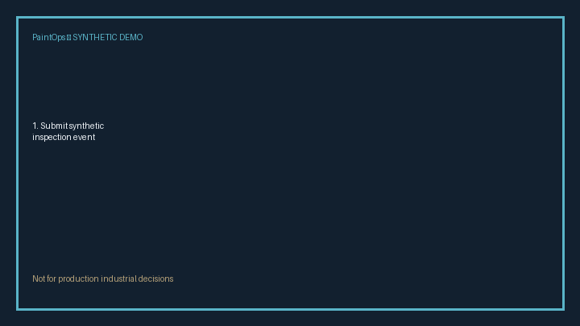
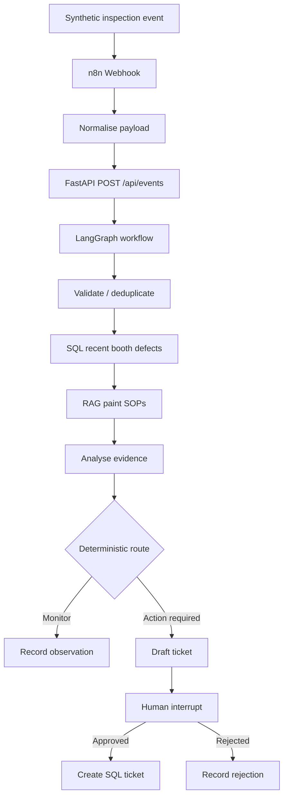

# PaintOps — Agentic Quality Deviation Investigation

An agentic quality-investigation workflow that turns **synthetic** automotive paint-inspection events into evidence-backed, human-approved maintenance or quality actions using **LangGraph**, **n8n**, **RAG**, and **SQL**.

> **SYNTHETIC decision-support demo only.** Events, SOPs, thresholds, and tickets are fictional portfolio examples. PaintOps does not connect to PLCs, robots, or production lines and never creates tickets without human approval.



## Problem and use case

A synthetic paint shop receives CV inspection events. Isolated defects may be noise; repeated same-booth defects can warrant investigation. PaintOps correlates history, retrieves synthetic SOPs, drafts an action proposal, and pauses for human approval.

## Architecture



Source diagram: [`docs/architecture.mmd`](docs/architecture.mmd).

**Business SQLite** (`data/paintops.db`) stores events, investigations, tickets, and audit rows. **Checkpoint SQLite** (`data/checkpoints/langgraph.db`) stores LangGraph thread state only.

## LangGraph workflow

Nodes: `validate_event` → `fetch_line_context` → `retrieve_sop` → `analyse_deviation` → `route_decision` → (`record_observation` | `draft_ticket` → `human_review` → `create_ticket` | `record_rejection`).

Routing is **deterministic Python** (`RECURRENCE_ACTION_THRESHOLD`, high/critical severity). The LLM (or `DEMO_MODE` rules) may summarise evidence but cannot bypass human approval.

## Example event

```json
{
  "event_id": "QC-2026-00421",
  "timestamp": "2026-10-30T09:15:00Z",
  "plant_id": "PLANT-01",
  "production_line": "PAINT-LINE-02",
  "booth_id": "BOOTH-03",
  "body_id": "CAR-008721",
  "defect_type": "orange_peel",
  "model_confidence": 0.94,
  "telemetry": {
    "booth_temperature_c": 24.5,
    "humidity_pct": 72.0,
    "airflow_m_s": 1.8
  },
  "source": "synthetic_cv_inspection"
}
```

## Data model

- `inspection_events` — one row per `event_id`
- `investigations` — one per event; statuses include `monitored`, `awaiting_approval`, `approved`, `rejected`
- `action_tickets` — unique on `investigation_id`; created **only** after approval
- `audit_events` — workflow/API audit trail

## n8n workflow

Import [`n8n/paintops_event_ingestion.json`](n8n/paintops_event_ingestion.json):

1. Webhook `POST /webhook/paintops-event`
2. Normalise fields (`source` defaults to `n8n_demo`)
3. HTTP Request → `http://api:8000/api/events` (Compose network)
4. Respond with FastAPI JSON

**Test webhook URL (Compose):** `http://localhost:5678/webhook/paintops-event`  
**Production:** use a secured public URL / reverse proxy — never expose unauthenticated webhooks.

## Evaluation

```bash
.\.venv\Scripts\python.exe evaluation\evaluate.py
```

Metrics are **measured** from `evaluation/test_cases.json` (synthetic labels). See `evaluation/last_results.json` after a run. Limitations: synthetic set, defect category comes from the fixture (no vision model), scores do not imply production readiness.

## Run locally

### Prerequisites

- Python 3.11 or 3.12
- Docker / Docker Compose (optional, for full stack + n8n)

### Quick start (venv)

```bash
cp .env.example .env
py -3.12 -m venv .venv
.\.venv\Scripts\python.exe -m pip install -e ".[dev]"
.\.venv\Scripts\python.exe scripts\seed_db.py
.\.venv\Scripts\python.exe scripts\build_sop_index.py
.\.venv\Scripts\python.exe -m uvicorn app.main:app --host 0.0.0.0 --port 8000 --workers 1
```

In another terminal:

```bash
.\.venv\Scripts\python.exe -m streamlit run ui\dashboard.py
```

### Docker Compose

```bash
cp .env.example .env
docker compose up --build
```

- API: http://localhost:8000/docs  
- Streamlit: http://localhost:8501  
- n8n: http://localhost:5678 (import the workflow JSON from `/import` or the repo `n8n/` folder)

`DEMO_MODE=true` runs deterministic analysis (`analysis_provider: demo_rules`) without paid LLM keys. The real graph, SQL, RAG, routing, checkpointing, and approval flow still execute.

### Example requests

Direct FastAPI:

```bash
curl -X POST http://localhost:8000/api/events ^
  -H "Content-Type: application/json" ^
  -d "{\"event_id\":\"QC-DEMO-1\",\"timestamp\":\"2026-10-30T09:15:00Z\",\"plant_id\":\"PLANT-01\",\"production_line\":\"PAINT-LINE-02\",\"booth_id\":\"BOOTH-03\",\"body_id\":\"CAR-008721\",\"defect_type\":\"orange_peel\",\"model_confidence\":0.94,\"telemetry\":{\"booth_temperature_c\":24.5,\"humidity_pct\":72.0,\"airflow_m_s\":1.8},\"source\":\"synthetic_cv_inspection\"}"
```

n8n webhook (after importing/activating the workflow):

```bash
curl -X POST http://localhost:5678/webhook/paintops-event ^
  -H "Content-Type: application/json" ^
  -d "{\"event_id\":\"QC-N8N-1\",\"timestamp\":\"2026-10-30T09:15:00Z\",\"plant_id\":\"PLANT-01\",\"production_line\":\"PAINT-LINE-02\",\"booth_id\":\"BOOTH-03\",\"body_id\":\"CAR-008721\",\"defect_type\":\"orange_peel\",\"model_confidence\":0.94,\"telemetry\":{\"booth_temperature_c\":24.5,\"humidity_pct\":72.0,\"airflow_m_s\":1.8}}"
```

### Tests and helpers

```bash
.\.venv\Scripts\python.exe -m pytest
.\.venv\Scripts\python.exe evaluation\evaluate.py
.\.venv\Scripts\python.exe scripts\seed_db.py
.\.venv\Scripts\python.exe scripts\build_sop_index.py
.\.venv\Scripts\python.exe scripts\make_demo_gif.py
```

Reset local demo DBs (destructive):

```bash
.\.venv\Scripts\python.exe scripts\reset_demo.py
```

## Limitations and safety

- All data and procedures are synthetic training examples.
- No PLC / OPC-UA / MQTT / ERP integration.
- No automatic production stop, parameter change, vehicle release, or rework authorisation.
- Every action ticket requires human approval; rejections create no tickets.
- Single-process `SqliteSaver` checkpointer — not horizontally scalable.

## Possible production evolution

- PostgreSQL for business data and durable checkpoints
- Authentication / RBAC for reviewers
- Observability (structured tracing, metrics)
- Real MES/QMS integration only after validation
- Azure Container Apps / AWS ECS + managed Postgres (see plan cloud notes)

## Spec

Full product specification: [`PAINTOPS_BUILD_PLAN.md`](PAINTOPS_BUILD_PLAN.md).
